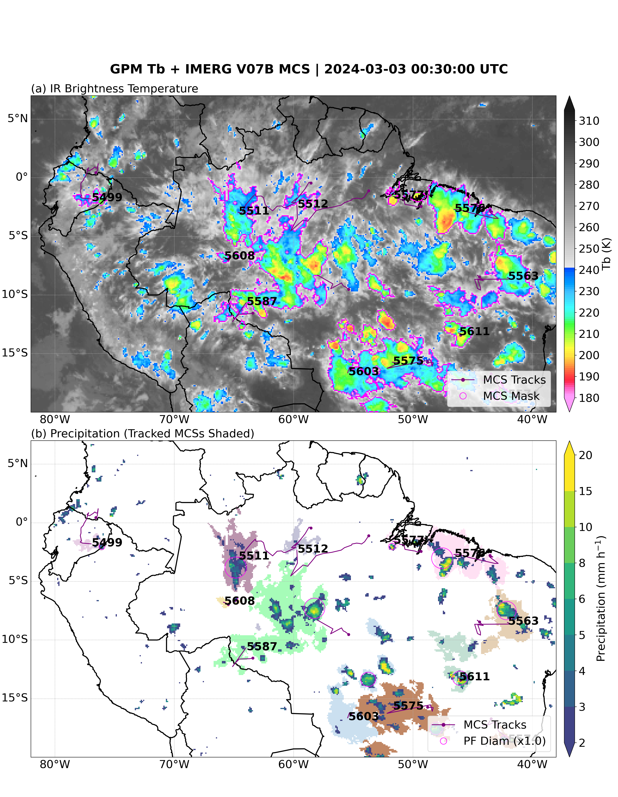
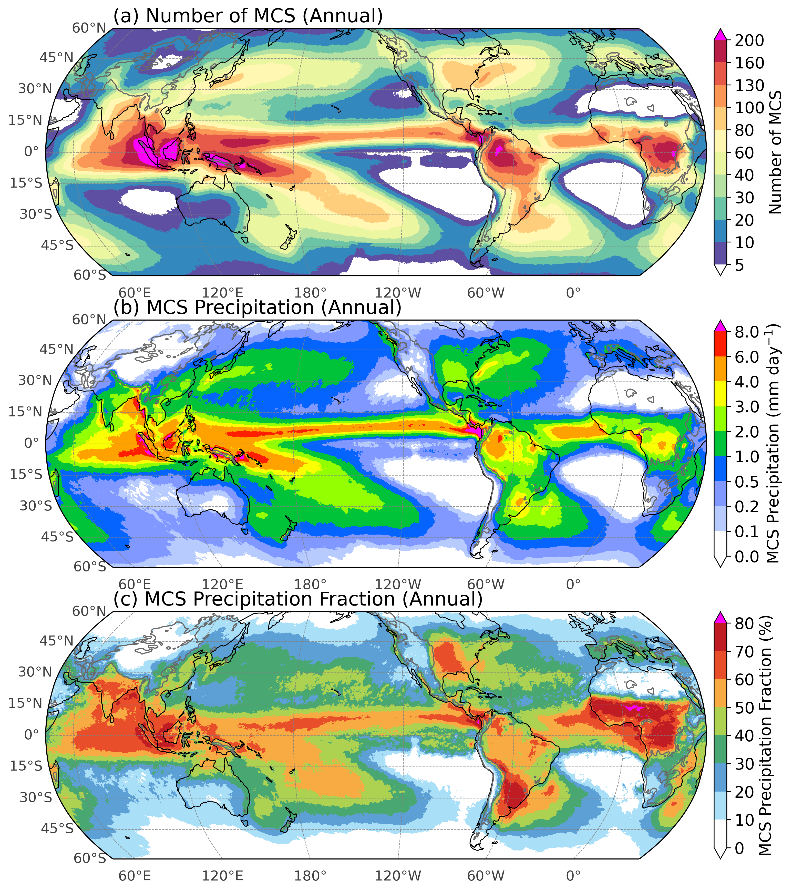
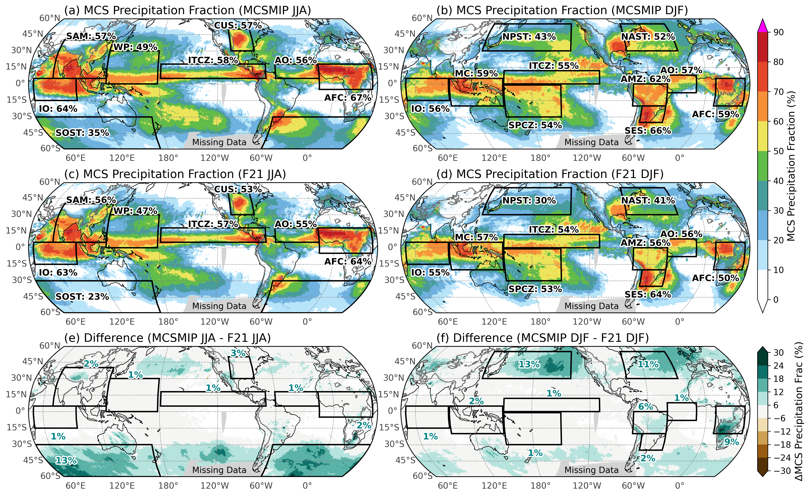
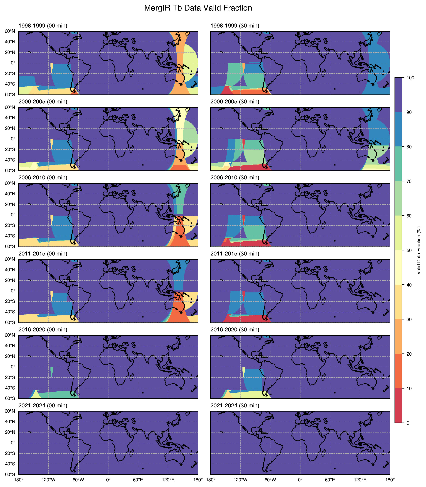
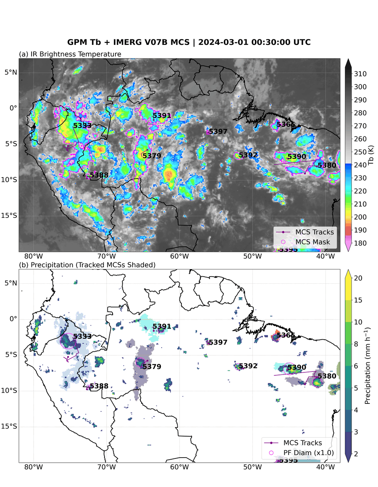
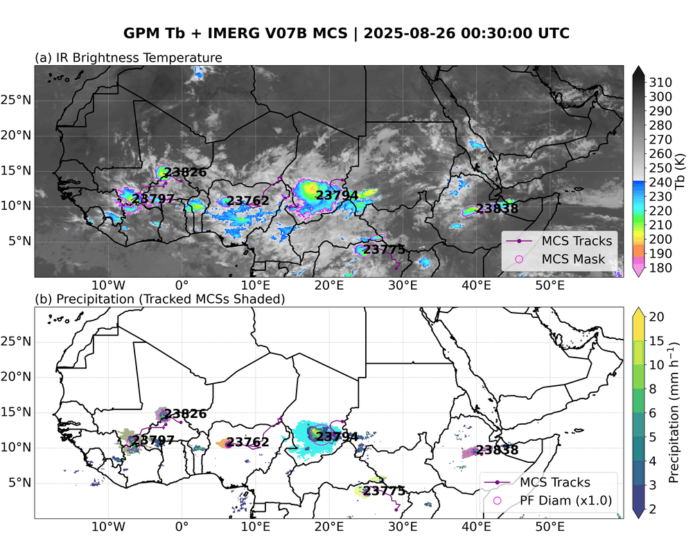

# Description of the PyFLEXTRKR Global MCS Tracking Dataset (Version 3)

Prepared by Zhe Feng (zhe.feng@pnnl.gov)
Pacific Northwest National Laboratory
Document version: V3, October 2026

> **Items still to be filled in before release** are marked `TODO` (V3 DOI, contents of the Zenodo package, and two incomplete TC-kept pixel sets).

<!--
To build a static PDF: the animated GIFs cannot be embedded in a PDF. Swap each GIF for its
static snapshot (figures/*_animation_static.png) before converting, for example:
  sed 's/\.gif)/_static.png)/g' README.md > README_pdf.md
  pandoc README_pdf.md -o README.pdf --toc
-->


---

## Contents

1. [Introduction](#1-introduction)
2. [V3 Major Updates](#2-v3-major-updates)
3. [Purpose](#3-purpose)
4. [MCS Tracking Algorithm](#4-mcs-tracking-algorithm)
5. [MCS Data Description](#5-mcs-data-description)
6. [MCS Climatology](#6-mcs-climatology)
7. [Missing IR Data and Impacts on Tracking Accuracy](#7-missing-ir-data-and-impacts-on-tracking-accuracy)
8. [MCS Snapshot Examples](#8-mcs-snapshot-examples)
9. [Known Issues and Usage Notes](#9-known-issues-and-usage-notes)
10. [Analysis Codes](#10-analysis-codes)
11. [References](#11-references)

---

## 1. Introduction

This document describes the global Mesoscale Convective System (MCS) tracking dataset developed by Feng et al. (2021). **Version 3 (V3)** is produced with the Python FLEXible object TRaKeR (PyFLEXTRKR; Feng et al., 2023) from satellite infrared brightness temperature (Tb) and **GPM IMERG Version 07B** precipitation, and is described in Zhang et al. (2026). It replaces the IMERG V06B-based V2 dataset (June 2000 – December 2020), because IMERG V06B processing has been discontinued.

| | V3 |
|---|---|
| Period | **1 January 1998 – 30 September 2025** (hourly) |
| Geographic coverage | 180°W–180°E, 60°S–60°N (periodic in longitude) |
| Grid | 0.1° × 0.1° (1200 × 3600), the IMERG grid |
| Time step | Hourly. Tb is the 30-minute-mark snapshot (hh:30 UTC); precipitation is the hourly mean |
| Input data | NOAA CPC/NCEP MergIR Tb + GPM IMERG V07B Final Run |
| MCS definitions | Two: **F21** (Feng et al. 2021, retuned for IMERG V07B) and **MCSMIP** (Feng et al. 2025) |
| Typical MCS count | About 34,800 (F21) and 41,100 (MCSMIP) tracks per year (1998–2024 mean, TC-excluded) |

---

## 2. V3 Major Updates

### 2.1 Input data

- **Precipitation: GPM IMERG V07B** (Final Run; Huffman et al. 2023), 1998–2025, 30-min and 0.1°. The 30-min precipitation is averaged to hourly rates for tracking.
- **IR brightness temperature: NOAA CPC/NCEP global merged IR (MergIR)** (Janowiak et al. 2017), 4 km and 30-min, regridded conservatively to the IMERG 0.1° grid. The 30-minute-mark snapshot of each hour is used because it has fewer missing data than the 00-minute snapshot over regions with frequent MCS occurrence (see [Section 7](#7-missing-ir-data-and-impacts-on-tracking-accuracy)) and is comparable to model outgoing longwave radiation.
- Differences between IMERG V07B and V06B that matter for MCS statistics (Zhang et al. 2026, Sections 3–4):
  - V07B has a 0.1° eastward PMW geolocation error corrected, and uses the SHARPEN scheme, which sharpens precipitation systems.
  - Over land, both versions underestimate heavy (10–25 mm h⁻¹) and intense (> 25 mm h⁻¹) rain compared with radar, and the underestimate is larger in V07B. Over the ocean V07B improves intense-rain retrievals.
  - As a result, **MCSs tracked in V07B have on average about 9–10% lower mean PF rain rate and about 26–31% lower heavy-rain volume ratio** than V06B-based MCSs, while MCS lifetime, minimum Tb, PF area and total rain volume are similar.
  - At 45°–60° in the winter hemisphere, V07B-based MCS frequency and rain contribution are lower than V06B.

### 2.2 Two MCS definitions

V3 provides MCS tracks under two definitions (Zhang et al. 2026, Section 2.5). Both share the same cloud-shield requirement and differ in the precipitation criteria.

| | **F21** (Feng et al. 2021, retuned for V07B) | **MCSMIP** (Feng et al. 2025; Prein et al. 2024) |
|---|---|---|
| Cold cloud shield (CCS) | Contiguous Tb < 241 K, area ≥ 40,000 km², lasting ≥ 4 consecutive hours, with Tb < 225 K at least once | Same |
| Precipitation criteria | Lifetime-dependent thresholds on the largest precipitation feature (PF, contiguous rain > 2 mm h⁻¹, major axis ≥ 100 km): PF area, PF mean rain rate, PF rain-rate skewness and heavy-rain (> 10 mm h⁻¹) volume ratio | Peak rain rate ≥ 10 mm h⁻¹ within the cloud shield throughout the 4-hour period, and rain volume ≥ 20,000 km² mm h⁻¹ at least once during the lifetime (equivalent to 2 mm h⁻¹ averaged over 100 km × 100 km) |
| PF size/shape criteria | Yes | No |
| Retuning for IMERG V07B | PF thresholds recalibrated (see [Section 4.3](#43-mcs-identification-two-definitions)); tuning is needed because V07B has more light-to-moderate and less heavy rain than V06B | None needed |
| Strictness | Stricter. Designed to improve mid-latitude MCS detection | Less stringent. Identifies about 18% more MCSs globally, and more MCSs in mid-latitude oceanic storm tracks in the cold season (Zhang et al. 2026, Section 4.4 and Fig. 9; see [Section 6](#6-mcs-climatology)) |
| Output folders | `Feng21/` | `MCSMIP/` |

### 2.3 PyFLEXTRKR improvements

PyFLEXTRKR (https://github.com/FlexTRKR/PyFLEXTRKR) gained several features between early 2025 and mid 2026 that are used in, or relevant to, global MCS tracking. Features specific to HEALPix, convective-cell tracking and software infrastructure are not listed.

| Feature | PyFLEXTRKR pull request | What it does for global MCS tracking |
|---|---|---|
| **Periodic boundary at the date line** | #110 (Mar 2025), #112, #136 (Apr 2026), #139 (May 2026) | Cloud and PF objects are labeled on a longitude-extended domain, so an MCS can cross 180° and remains **one object and one track**. Track positions are continuous across the boundary and `pbc_flag` marks the tracks affected (see [Section 5.4](#54-tracks-crossing-the-date-line)). Config keys: `pbc_direction`, `pbc_extended_fraction`, `pbc_max_domain_fraction` |
| **Smoothed trajectories** | #114 (Apr 2025) | New variables `meanlon_smooth` / `meanlat_smooth`: positions that jump faster than `max_speed_for_trajectory_smoothing` (40 m s⁻¹) because of merging/splitting or segmentation are interpolated. For visualization only; tracking is unchanged |
| **Latitude-dependent pixel area** | #135 (Mar 2026) | `area_method: latlon` computes the true area of every grid cell, so cloud, PF and rain-volume statistics are not biased at high latitudes. Adds `total_volrain` and `total_heavyvolrain` (area-integrated rain volume) |
| **Periodic-boundary-aware PF statistics and speed** | #136 (Apr 2026) | PF longitudes/latitudes are computed with a circular mean, and movement speed accounts for periodic wrap, for MCSs crossing the boundary (but see the known issue in [Section 9](#9-known-issues-and-usage-notes)) |
| **New rain statistics** | #128 (Jan 2026) | New variable `rainrate_p95` (95th percentile rain rate under the cloud shield) |
| **MCSMIP definition** | `robustmcspf_saag.py` (from the SAAG tracking, PR #33, Dec 2022), run with `runscripts/run_mcs_tbpf_mcsmip.py` | Implements the MCSMIP criteria (peak rain rate and rain-volume thresholds). First used for a global dataset in V3 |
| **Tracks longer than the preset range** | #139 (May 2026) | `duration_range_auto_update` extends the maximum track duration instead of stopping when a track is longer than `duration_range` (available in PyFLEXTRKR; the V3 production configs use `duration_range: [2, 400]`) |
| **Quicklook and animation scripts** | #118, #125, #130 | `Analysis/make_mcs_animation.py` and plotting scripts handle cross-dateline domains, use smoothed trajectories, and have configurable map options |

### 2.4 Other changes from V2

- **Two product families per definition** (see [Section 5.1](#51-directory-structure-and-file-names)): `final_extc` (**recommended**), `final`, and `robust`.
- **`extc`** (excluding tropical cyclones): MCS tracks that overlap a tropical cyclone (IBTrACS) are removed; see [Section 4.3](#43-mcs-identification-two-definitions) for the method and [Section 9](#9-known-issues-and-usage-notes) for its limitations. In 2020 this removes 941 of 36,790 tracks (2.6%) for F21.
- Variable names in the pixel files changed from V2 (see Table 1), and new variables were added to the statistics files (see Table 2).
- The movement direction `movement_theta` is now a compass bearing (see Table 2), so the V2 caution about its definition no longer applies.
- The pixel-level data are written for each hour at hh:30 UTC. A time step is skipped when ≥ 40% of the global Tb grid is missing after small gaps are filled (config `miss_thresh: 0.4`), so files exist for nearly every hour (for example 8,757 of 8,784 hours in 2024). Regional Tb gaps smaller than this do not remove a time step (see [Section 7](#7-missing-ir-data-and-impacts-on-tracking-accuracy)).

---

## 3. Purpose

The purpose of PyFLEXTRKR is to provide automated identification and lifecycle evolution of individual MCS events, along with a suite of MCS characteristics, including lifetime, infrared brightness temperature (Tb) defined cloud shield (cold cloud cores and surrounding cold anvils), surface precipitation feature characteristics, movement, and more. PyFLEXTRKR can be applied to observations and model simulations, facilitating their objective and statistical comparisons.

---

## 4. MCS Tracking Algorithm

All user-defined parameters are set in the config file in yaml format (`Feng21/config_imerg_mcs_tbpf.yml`, `MCSMIP/config_mcs_tbpf_imergv7_mcsmip.yml`), and key parameters are recorded in the global attributes of the track statistics files. PyFLEXTRKR first identifies and tracks large cold cloud systems (CCSs) associated with deep convection using Tb data, then identifies MCSs using the collocated precipitation. For method details see Feng et al. (2018, 2021, 2023) and Section 2.5 of Zhang et al. (2026).

### 4.1 Cold cloud system identification

CCSs are identified with a **detect-and-spread** method:

1. The Tb field is smoothed with a 10-grid-point (~100 km) box filter. Contiguous regions with smoothed Tb < 225 K (at least 4 grid points) are labeled as **cold cores**.
2. Each core is expanded outward until the original (unsmoothed) Tb reaches 241 K, giving the **cold anvil** and the full **cold cloud shield (CCS)**.
3. Missing Tb pixels are filled with a 5 × 5 median filter; Tb outside 160–330 K is discarded; clouds smaller than 800 km² are not tracked.
4. CCSs that share a large precipitation feature are **linked** (`linkpf: 1`). Rain rate is smoothed with a 5 × 5 filter and regions ≥ 3 mm h⁻¹ and ≥ 648 km² are labeled as PFs used to link CCSs. A CCS cut in two by a gap in the cold shield but sharing one PF is thus treated as one system.

### 4.2 Tracking

CCSs in consecutive hours are linked when they overlap by more than 50% (`othresh: 0.5`). Merging and splitting are handled explicitly, and the track follows the larger object. Tracking restarts if data are missing for more than 3.1 hours (`timegap`). Periodic boundary conditions in longitude are used (`pbc_direction: x`) so that objects and tracks are continuous across the date line.

### 4.3 MCS identification (two definitions)

A tracked CCS is an MCS if it satisfies the cloud-shield criteria and the precipitation criteria of the chosen definition. Once identified, the entire track (initiation, mature and decay phases) is labeled and written to the output; the `mcs_status` and `pf_mcsstatus` flags mark the times when the Tb and precipitation criteria are met.

**Common cloud-shield criteria (both definitions):** CCS (Tb < 241 K) area ≥ 40,000 km² (`mcs_tb_area_thresh`) for ≥ 4 consecutive hours (`mcs_tb_duration_thresh`), allowing a 1-hour gap (`mcs_tb_gap`), with Tb < 225 K observed at least once. Small tracks (≤ 12 hours) that merge into or split from an MCS are included with that MCS (`mcs_tb_merge_duration`, `mcs_tb_split_duration`).

**F21 precipitation criteria (retuned for IMERG V07B).** Over a period of ≥ 4 hours (`mcs_pf_durationthresh`), the largest PF (rain > 2 mm h⁻¹; major axis 100–1,800 km) must exceed thresholds that can depend on the period length *L* (hours):

| PF parameter | Threshold = intercept + slope × *L* | Percentile of radar-defined MCS PFs |
|---|---|---|
| PF area (km²) | 3526.92 + 80.935 × *L* | 14th |
| PF mean rain rate (mm h⁻¹) | 3.31265 | 8th |
| PF rain-rate skewness | 0.136783 | 2nd |
| Heavy-rain volume ratio (%) | 4.833391 | 20th |

Here the heavy-rain volume ratio is the accumulated rain from pixels > 10 mm h⁻¹ divided by the total accumulated PF rain over the period. The first three parameters must be exceeded simultaneously for ≥ 4 hours, and the heavy-rain ratio must be exceeded for the period. The coefficients are stored in the global attributes `coefs_pf_area`, `coefs_pf_rr`, `coefs_pf_skew` and `coefs_pf_heavyratio` as [intercept, slope]. The percentiles were obtained by optimizing the MCS share of total precipitation against the radar-based V3 CONUS MCS database (NEXRAD + Stage IV, 2004–2021; Feng 2024), following Feng et al. (2021), so that the V07B-based statistics stay consistent with V06B (Zhang et al. 2026, Sections 2.6 and 4.1). Compared with V06B, intensity-related thresholds (mean rain rate, heavy-rain ratio) are lower and the area threshold is higher. For simplicity the lifetime slopes of the last three parameters are set to zero.

**MCSMIP precipitation criteria.** There is no PF size or shape requirement (`mcs_pf_majoraxis_thresh: 0`). The peak PF rain rate must be ≥ 10 mm h⁻¹ for at least 4 hours of the period, and the total rain volume under the cloud shield must exceed 20,000 km² mm h⁻¹ (`mcs_min_rainvol_thresh`) for at least 1 hour (`mcs_volrain_duration_thresh`). The global attributes `mcs_min_rainvol_thresh` and `mcs_volrain_duration_thresh` record these values.

**Tropical cyclone exclusion (`extc`).** After the MCS tracks are identified, tracks that overlap tropical cyclones are removed, which gives the `final_extc` statistics files and the `mcstracking_extc_*` pixel files. Tropical cyclone positions come from the IBTrACS v04r01 best-track records (about 124,000 records with a valid radius in 1998–2025). Each record's radius of the outermost closed isobar (ROCI) is taken from the first available of `USA_ROCI`, `TOKYO_R30_LONG`, `BOM_ROCI`, or the largest `REUNION_R34_*` radius, converted from nautical miles to km (1 nautical mile = 1.852 km); only records with 0 < ROCI < 2000 km are used. For each hourly pixel file, a circle of radius ROCI is constructed around **every** tropical cyclone record within ±3 hours of the MCS time (IBTrACS records are 3-hourly), using great-circle distance and handling the date line, and every MCS track whose `cloudtracknumber` mask overlaps any circle is flagged. A track that overlaps a tropical cyclone at any hour is removed entirely, and the pixel-level files are re-labeled with the remaining tracks. The scripts (`preprocess_tc_ibtracs.py`, `find_mcs_tracks_in_tc.py`, `filter_mcs_tracks_ar_tc.py` and `mcsmip_filter_mcs_tracks_ar_tc.py`) are in https://github.com/WACCEM/gpm_mcs_post/tree/pyflextrkr/v3_global_tc. The `final` and `robust` files are not filtered. Limitations of this approach are listed in [Section 9](#9-known-issues-and-usage-notes).

---

## 5. MCS Data Description

### 5.1 Directory structure and file names

```
Feng21/                          (F21 definition)            MCSMIP/                          (MCSMIP definition)
  mcstracking_extc_f21/            pixel-level, TC excluded    mcstracking_extc_mcsmip/
  mcstracking_f21/                 pixel-level, TC kept        mcstracking_mcsmip/
  stats_f21/                       track statistics            stats_mcsmip/
  config_imerg_mcs_tbpf.yml        tracking configuration      config_mcs_tbpf_imergv7_mcsmip.yml
```

Pixel-level files are in yearly sub-directories named by the tracking period (for example `20200101.0000_20210101.0000`; the last period is `20250101.0000_20251001.0000`):

`mcstracking_extc_f21/yyyymmdd.hhmm_yyyymmdd.hhmm/mcstrack_yyyymmdd_hhmmss.nc`  (for example `mcstrack_20200101_003000.nc`)

Track statistics files, one per tracking period:

| File | Content |
|---|---|
| `mcs_tracks_final_extc_<start>_<end>.nc` (MCSMIP: `mcsmip_mcs_tracks_final_extc_*`) | **Recommended.** Final MCS track statistics, tropical cyclones excluded. Matches the `mcstracking_extc_*` pixel files |
| `mcs_tracks_final_<start>_<end>.nc` | Same, tropical cyclones kept. Matches the `mcstracking_*` pixel files |
| `mcs_tracks_robust_<start>_<end>.nc` | Intermediate product (MCSs identified, before the movement-speed step); normally not needed |

Examples used in this document: `stats_f21/mcs_tracks_final_extc_20200101.0000_20210101.0000.nc` (35,849 tracks) and `mcstracking_extc_f21/20200101.0000_20210101.0000/mcstrack_20200101_003000.nc`.

The monthly and annual gridded products used for the climatology figures (MCS precipitation, MCS precipitation/cloud hours, and MCS number; sub-directories `monthly/` and `monthly_extc/` of the stats folders) are derived from the pixel files with `cloudtracknumber > 0` (MCS cloud and rainfall) and `pcptracknumber > 0` (MCS precipitation hours).

**Data access.** The track statistics, monthly and climatology files are archived on Zenodo (`TODO: V3 DOI and Zenodo package contents`). The full pixel-level dataset (see the volume table below) is shared through NERSC Globus on request. Please contact Zhe Feng (zhe.feng@pnnl.gov) with a short description of the intended use, and a Globus link to the V3 folder (`MCS_Global/V3/`) will be provided; access is granted per request so that data usage can be tracked. (V2 is at `MCS_Global/V2/`.)

**Data volume.** Sizes were measured in October 2026 (apparent file sizes; 1 GB = 10⁹ bytes, 1 TB = 10¹² bytes). All files are NetCDF4.

| Product | Feng21 | MCSMIP | Both |
|---|---|---|---|
| Pixel-level files, TC excluded (`mcstracking_extc_*`), **recommended** | 3.33 TB (242,975 files) | 3.35 TB (242,975 files) | 6.68 TB (485,950 files) |
| Pixel-level files, TC kept (`mcstracking_*`) | 3.27 TB (238,283 files) | 3.35 TB (242,427 files) | 6.62 TB (480,710 files) |
| Track statistics `final_extc` (**recommended**) | 9.95 GB (28 files) | 11.56 GB (28 files) | 21.51 GB (56 files) |
| Track statistics `final` (TC kept) | 10.24 GB (28 files) | 11.87 GB (28 files) | 22.11 GB (56 files) |
| Track statistics `robust` (intermediate) | 9.60 GB (28 files) | 11.12 GB (28 files) | 20.72 GB (56 files) |
| Monthly rain maps, TC excluded (`monthly*/rainmap`) | 7.18 GB (333 files) | 7.54 GB (333 files) | 14.72 GB (666 files) |
| Monthly statistics maps, TC excluded (`monthly*/statsmap`) | 26.33 GB (333 files) | 29.42 GB (333 files) | 55.75 GB (666 files) |
| Multi-year climatology, TC excluded (`monthly*/timmean_1998_2024`) | 0.27 GB (6 files) | 0.28 GB (6 files) | 0.55 GB (12 files) |
| Monthly rain maps and climatologies, TC kept (`monthly/`) | – | 9.33 GB (326 files) | 9.33 GB (326 files) |
| **Total per definition** | **6.67 TB (482,014 files)** | **6.78 TB (486,484 files)** | **13.45 TB (968,498 files)** |
| Recommended subset (TC-excluded pixel files, `final_extc` stats, monthly and climatology) | 3.38 TB (243,675 files) | 3.40 TB (243,675 files) | 6.78 TB (487,350 files) |
| Ancillary (`MergedIR_ValidData` valid-data statistics, `map_data`) | | | 0.38 GB (357 files) |
| **Grand total** | | | **13.45 TB (968,855 files)** |

In the table, `monthly*` is the `monthly/` folder for Feng21 (built from the TC-excluded pixel files) and the `monthly_extc/` folder for MCSMIP; the MCSMIP `monthly/` folder holds the TC-kept rain maps. Pixel-level files exist for nearly every hour of the period (about 8,720–8,780 files per year, 6,552 in 2025). All 28 yearly statistics files exist for each product. `TODO: the TC-kept pixel sets are incomplete for Feng21 in 2013 (4,067 of 8,759 files) and for MCSMIP in 2009 (8,210 of 8,758 files); regenerate before release. The TC-excluded pixel sets are complete.`

### 5.2 Hourly pixel-level data

The pixel-level data are on the 0.1° IMERG grid (`lat` = 1200, `lon` = 3600; latitudes −59.95 to 59.95, longitudes −179.95 to 179.95). Each file contains the full Tb and precipitation fields together with the cloud object and MCS track number masks. Figure 1 shows an example.

**Table 1. Pixel-level data variables.** All variables have dimensions (time, lat, lon) unless noted.

| Variable | Dimension | Description |
|---|---|---|
| `time` | time | Epoch time (seconds since 1970-01-01), the Tb snapshot time (hh:30 UTC) |
| `base_time` | time | Epoch time (same as `time`) |
| `lon`, `lat` | lon; lat | Longitude and latitude of each column/row |
| `longitude`, `latitude` | lat, lon | 2-D longitude and latitude of each grid cell |
| `tb` | time, lat, lon | Brightness temperature, K (30-min snapshot, full field; NaN where missing) |
| `precipitation` | time, lat, lon | IMERG V07B precipitation, mm h⁻¹ (hourly mean, full field) |
| `cloudtype` | time, lat, lon | Cloud classification from Tb: 1 = cold core (Tb ≤ 225 K), 2 = cold anvil (225–241 K), 3 = warm anvil (241–261 K), 0 = missing Tb. Pixels with the fill value (5, read as NaN by most readers) are not cloud (Tb > 261 K) |
| `cloudnumber` | time, lat, lon | Number of the cloud object at each pixel (after linking by `pf_number`); not tracked. Identical to `feature_number` |
| `feature_number` | time, lat, lon | Cloud feature number used for tracking. Matches `cloudnumber` in the track statistics files |
| `nfeatures` | time | Number of features labeled in this file |
| `pf_number` | time, lat, lon | Precipitation feature number used to link clouds (Section 4.1) |
| `cloudnumber_orig`, `convcold_cloudnumber_orig` | time, lat, lon | Cloud numbers before linking by `pf_number` (intermediate; not needed for analysis) |
| `tracknumber` | time, lat, lon | MCS track number at each pixel, **excluding** the merge/split clouds (corresponds to V2 `cloudtracknumber_nomergesplit`) |
| `cloudtracknumber` | time, lat, lon | **MCS track number mask, including** the small merge/split clouds renumbered to the main MCS track. The main mask for locating MCSs (corresponds to V2 `cloudtracknumber`) |
| `cloudmerge_tracknumber` | time, lat, lon | Part of `cloudtracknumber` that comes from small tracks merging into the MCS |
| `cloudsplit_tracknumber` | time, lat, lon | Part of `cloudtracknumber` that comes from small tracks splitting from the MCS |
| `merge_tracknumber` | time, lat, lon | Track number of the MCS that this cloud merges into (V2 `merge_tracknumbers`) |
| `split_tracknumber` | time, lat, lon | Track number of the MCS that this cloud splits from (V2 `split_tracknumbers`) |
| `track_status` | time, lat, lon | Internal flag of the track's merge/split history at each pixel; not needed for typical analysis (to identify merge/split tracks see Section 5.3.1) |
| `pcptracknumber` | time, lat, lon | MCS track number applied only to precipitating pixels: `cloudtracknumber` where `precipitation` > 1 mm h⁻¹ (`precipitation_threshold` attribute) |

Global attributes record the Tb thresholds (`tb_threshold_core` 225, `tb_threshold_coldanvil` 241, `tb_threshold_warmanvil` 261), `minimum_cloud_area`, `linkpf`, and `pbc_direction`.

The MCS track numbers in `cloudtracknumber` and `pcptracknumber` are the same, but differ in coverage. `cloudtracknumber` is defined using Tb and covers the whole cloud shield, usually including most of the precipitation in the vicinity of the MCS. `pcptracknumber` covers only the precipitating pixels.

**Track numbers are not unique across tracking periods.** Within each yearly sub-directory the track number increases from 1 to X (X = number of MCSs in that period). `cloudtracknumber = 1` in many files of one period denotes the first MCS tracked in that period, and there will also be a track number 1 in the next period. Each period is tied to one track statistics file containing the time and location of every MCS, so tracks can be distinguished across periods if desired.

If no cloud is identified at a given hour, or the Tb data are largely missing (≥ 40% of the global grid), there is no pixel-level file for that time. Smaller regional gaps in Tb do not remove the file (see [Section 7](#7-missing-ir-data-and-impacts-on-tracking-accuracy)).



**Figure 1.** Example snapshot of the pixel-level data over the Amazon, 3 March 2024 00:30 UTC (F21). (a) IR brightness temperature, (b) IMERG V07B precipitation. The magenta contour in (a) and the color shadings in (b) denote MCS masks (`cloudtracknumber`). Purple lines are MCS tracks, purple dots are initiation locations, and numbers are MCS track numbers. Magenta circles in (b) show the largest PF equivalent diameter within an MCS. More examples in [Section 8](#8-mcs-snapshot-examples).

### 5.3 Track statistics data

Each tracking period corresponds to one track file. The statistics describe the timing, location and evolution of each MCS. Variables are organized by [`tracks`, `times`]:

| Dimension | Size (2020 file) | Meaning |
|---|---|---|
| `tracks` | 35,849 (varies; unlimited) | Number of MCSs in the period. Matches the track number in the pixel files: `tracks = 0` is `cloudtracknumber = 1` |
| `times` | 400 | Relative time since the MCS was first detected as a CCS. `times = 0` is the initiation time. `base_time` gives the actual time |
| `mergers` | 50 | Maximum number of clouds that can merge into or split from one MCS at one time |
| `nmaxpf` | 3 | Number of largest PFs saved within each cloud shield. `nmaxpf = 0` is the largest PF |

Variables derived from IR Tb have dimensions [`tracks`, `times`]; variables derived from precipitation features have [`tracks`, `times`, `nmaxpf`]. Only the first `track_duration` entries of `times` are valid for a track; the rest are fill values. Global attributes record the MCS configuration (`MCS_duration_hr` 4, `MCS_area_km^2` 40000, `PF_rainrate_thresh` 2, `heavy_rainrate_thresh` 10, the coefficients `coefs_pf_*` for F21, `mcs_min_rainvol_thresh` for MCSMIP, `time_resolution_hour` 1, `timegap_hour` 3.1, `max_speed_thresh` 50) and the pixel length statistics.

**Table 2. Track statistics variables** (`mcs_tracks_final_extc_*.nc`). New variables in V3 are marked **new**.

*Track-level variables (tracks)*

| Variable | Dimension | Units | Description |
|---|---|---|---|
| `track_duration` | tracks | – | Duration of each tracked CCS: the longest lifetime of an MCS, which may include times before and after precipitation. Multiply by `time_resolution_hour` for hours |
| `mcs_duration` | tracks | – | Duration of the MCS stage (CCS area > MCS area threshold). Multiply by `time_resolution_hour` for hours |
| `pf_lifetime` | tracks | hour | MCS lifetime when a significant PF is present (the active precipitation period) |
| `start_basetime`, `end_basetime` | tracks | s since 1970-01-01 | Start and end Epoch time of each track |
| `start_split_cloudnumber` | tracks | – | Cloud number where this track splits from (> 0 if the track starts as a split) |
| `end_merge_cloudnumber` | tracks | – | Cloud number where this track merges with (> 0 if the track ends as a merger) |
| `pbc_flag` | tracks | – | **new.** 1 if the track position was adjusted because the track crosses the periodic boundary (date line); 0 otherwise |

*Location, time and CCS properties (tracks, times)*

| Variable | Dimension | Units | Description |
|---|---|---|---|
| `base_time` | tracks, times | s since 1970-01-01 | Epoch time of each MCS at each time |
| `meanlat`, `meanlon` | tracks, times | degrees | Mean latitude / longitude of the MCS (cloud object). **Continuous across the date line, so `meanlon` can be outside [−180, 180]** for tracks with `pbc_flag = 1` (Section 5.4) |
| `meanlat_smooth`, `meanlon_smooth` | tracks, times | degrees | **new.** Smoothed latitude / longitude, with jumps faster than 40 m s⁻¹ interpolated. For visualization of trajectories |
| `lat_mintb`, `lon_mintb` | tracks, times | degrees | **new.** Location of the minimum Tb in the cloud (longitude within [−180, 180]) |
| `area` | tracks, times | km² | Area of the tracked cloud feature (not described in the V2 README) |
| `ccs_area` | tracks, times | km² | Area of the cold cloud shield (core + cold anvil, Tb < 241 K); used for the MCS area criterion |
| `core_area` | tracks, times | km² | Area of the cold core |
| `cold_area` | tracks, times | km² | Area of the cold anvil |
| `corecold_mintb` | tracks, times | K | Minimum Tb in core + cold anvil area |
| `corecold_meantb` | tracks, times | K | Mean Tb in core + cold anvil area |
| `core_meantb` | tracks, times | K | Mean Tb in cold core area |
| `cloudnumber` | tracks, times | – | Cloud number in the corresponding pixel file (`feature_number`) |
| `track_status` | tracks, times | – | Internal flag of the track's merge/split history; not needed for typical analysis (Section 5.3.1) |
| `track_interruptions` | tracks, times | – | 0 = full track available; 1 = track starts at the first file, cut short by data availability; 2 = track ends at the last file, cut short |
| `mcs_status` | tracks, times | – | Flag for the MCS status based on Tb: 1 = yes, 0 = no |
| `pf_mcsstatus` | tracks, times | – | Flag for the MCS status based on precipitation: 1 = yes, 0 = no |

*Merge and split (tracks, times, mergers)*

| Variable | Dimension | Units | Description |
|---|---|---|---|
| `merge_cloudnumber` | tracks, times, mergers | – | Cloud numbers that merge into the MCS |
| `split_cloudnumber` | tracks, times, mergers | – | Cloud numbers that split from the MCS |
| `merge_ccs_area` | tracks, times, mergers | km² | Cold cloud shield area that merges into the MCS |
| `split_ccs_area` | tracks, times, mergers | km² | Cold cloud shield area that splits from the MCS |

*Rain statistics under the cloud shield (tracks, times)*

| Variable | Dimension | Units | Description |
|---|---|---|---|
| `pf_npf` | tracks, times | – | Number of PFs under the cloud shield |
| `pf_landfrac` | tracks, times | fraction | Fraction of PF over land |
| `total_rain` | tracks, times | mm h⁻¹ | Sum of the pixel rain rates under the cloud shield (all rain included). Not area-weighted |
| `total_heavyrain` | tracks, times | mm h⁻¹ | Sum of pixel rain rates > 10 mm h⁻¹ under the cloud shield. Not area-weighted |
| `total_volrain` | tracks, times | mm h⁻¹ km² | **new.** Rain volume under the cloud shield (rain rate × pixel area, latitude-dependent area) |
| `total_heavyvolrain` | tracks, times | mm h⁻¹ km² | **new.** Heavy-rain (> 10 mm h⁻¹) volume under the cloud shield |
| `rainrate_heavyrain` | tracks, times | mm h⁻¹ | Mean heavy rain rate under the cloud shield |
| `rainrate_p95` | tracks, times | mm h⁻¹ | **new.** 95th percentile of rain rate (pixels > 2 mm h⁻¹) under the cloud shield |

*Precipitation feature (PF) statistics (tracks, times, nmaxpf)*, organized by size (`nmaxpf = 0` is the largest PF):

| Variable | Units | Description |
|---|---|---|
| `pf_area` | km² | PF area under the cloud shield |
| `pf_lon`, `pf_lat` | degrees | Mean longitude / latitude of each PF |
| `pf_lon_centroid`, `pf_lat_centroid` | degrees | Centroid of each PF |
| `pf_lon_weightedcentroid`, `pf_lat_weightedcentroid` | degrees | Rain-rate weighted centroid of each PF |
| `pf_lon_maxrainrate`, `pf_lat_maxrainrate` | degrees | **new.** Location of the maximum rain rate in each PF |
| `pf_rainrate` | mm h⁻¹ | Mean rain rate of each PF |
| `pf_maxrainrate` | mm h⁻¹ | Maximum rain rate of each PF |
| `pf_skewness` | – | Pixel-level rain-rate skewness of each PF |
| `pf_accumrain` | mm h⁻¹ | Sum of the pixel rain rates of each PF |
| `pf_accumrainheavy` | mm h⁻¹ | Sum of the pixel rain rates > 10 mm h⁻¹ of each PF |
| `pf_majoraxis`, `pf_minoraxis` | km | PF major / minor axis length |
| `pf_aspectratio` | – | PF aspect ratio (major / minor axis length). Named `pf_aspecratio` in the V2 description |
| `pf_orientation` | degrees | Orientation of the PF major axis |
| `pf_eccentricity` | – | Eccentricity of the PF |
| `pf_perimeter` | km | **new.** PF perimeter |

*Movement (tracks, times)*

| Variable | Units | Description |
|---|---|---|
| `movement_distance` | km | Movement distance along `movement_theta` between lag steps |
| `movement_speed` | m s⁻¹ | Movement speed along `movement_theta`. Speeds > 50 m s⁻¹ are replaced by a temporal filter |
| `movement_theta` | degrees | Movement direction as a compass bearing of the direction the MCS **moves toward**: 0 = northward, 90 = eastward, 180 = southward, 270 = westward. (Not a meteorological wind direction, which is the direction the wind comes from) |
| `movement_distance_x`, `movement_distance_y` | km | East–west and north–south components of the movement distance |

Movement of MCS PFs is estimated with a 2-D cross-correlation between consecutive hours (`lag_for_speed: 1`) of the precipitation field inside the MCS; the method is described in Feng et al. (2018). Movement is computed only for MCSs with a PF major axis ≥ 20 km, and it accounts for the periodic boundary.

#### 5.3.1 Identifying merge/split tracks

An MCS track can start as a split from another system and can end by merging into another system. Identify them with:

- `start_split_cloudnumber > 0`: the track **starts as a split** (36% of the tracks in the 2020 F21 file).
- `end_merge_cloudnumber > 0`: the track **ends as a merger** (34% of the tracks in the 2020 F21 file).

All other tracks initiate or decay without splitting from or merging into another MCS. Both variables are missing (fill value) where there is no split or merge, so a test such as `> 0` is false there. The cloud numbers of the clouds that merge into or split from an MCS at each time are in `merge_cloudnumber` and `split_cloudnumber`.

### 5.4 Tracks crossing the date line

The domain is periodic in longitude, so an MCS that crosses 180° is a single object and a single track (before V3 the domain edge cut such systems into two). Tracks that cross the boundary are flagged by `pbc_flag = 1` (568 of 35,849 tracks, 1.6%, in the 2020 F21 file). For those tracks `meanlon` and `meanlon_smooth` are kept **continuous** (for example 178°, 181°, 184° rather than 178°, −179°, −176°), so they can lie outside [−180, 180] (about −216° to +244° in 2020). Wrap them with

```python
lon_wrapped = (lon + 180.0) % 360.0 - 180.0     # to [-180, 180)
lon_360     = lon % 360.0                       # to [0, 360)
```

before mapping or matching with the pixel files. `lon_mintb` and the pixel-file `lon` are always within [−180, 180]. See also the known issue about PF longitudes in [Section 9](#9-known-issues-and-usage-notes).

### 5.5 Linking track statistics with pixel-level data

The MCS mask values in `cloudtracknumber` of a pixel file correspond to the `tracks` dimension of the track statistics file of the same period (offset by 1 for 0-based indexing): `cloudtracknumber = N` is `tracks = N − 1`. To find the MCSs present at a given time, match `base_time` in the track statistics to the `time` of the pixel file:

```python
import xarray as xr, numpy as np, pandas as pd

pix = xr.open_dataset("mcstrack_20200101_003000.nc")
st  = xr.open_dataset("mcs_tracks_final_extc_20200101.0000_20210101.0000.nc")

# Epoch time of the pixel file
t = pix.time.values[0]

# Indices (track, time) of all MCSs that exist at this hour
tt = pd.to_datetime(st.base_time.values.ravel(), unit="s").values.reshape(st.base_time.shape)
itrack, itime = np.where(tt == np.datetime64(t))

# Mask of the MCS in the pixel file that belongs to track index itrack[k]
k = 0
mask = pix.cloudtracknumber.squeeze() == itrack[k] + 1
# Its statistics at this hour
area = st.ccs_area.values[itrack[k], itime[k]]
```

Because `base_time` contains the full date and time, it identifies the exact hour, and the matching `times` index is the number of hours since the MCS was first detected. The cloud number of each MCS at this hour (`cloudnumber` in the statistics) corresponds to `feature_number` in the pixel file.

---

## 6. MCS Climatology

The figures in this section use the 27 complete years **1998–2024** of the TC-excluded (`extc`) data. Methods and a longer discussion are in Zhang et al. (2026) (Section 4); note that the paper's Figures 7 and 9 use 2011–2020.

### 6.1 Global MCS climatology (F21 definition)



**Figure 2.** Annual mean MCS climatology for 1998–2024 (F21 definition, IMERG V07B): (a) number of MCSs per year (tracks whose cloud shield covers a location), (b) MCS precipitation (mm day⁻¹), (c) MCS contribution to total precipitation (%). Gray contours show orography.

MCS number (a) and precipitation (b) are highest over the Maritime Continent and eastern Indian Ocean (more than 160 MCSs per year), the western Pacific warm pool and the SPCZ, the Pacific ITCZ and the Colombia/Panama coast, the Amazon basin, and central Africa. Secondary maxima appear over the Bay of Bengal and the Indian monsoon region, the Sahel and West Africa, the La Plata basin, and the U.S. Great Plains and Gulf Stream region. The MCS contribution to total precipitation (c) is 50–70% over the tropical warm pool and much of the ITCZ, reaches 70–80% over central Africa and the Sahel, and is 60–70% over the Bay of Bengal and India, the La Plata basin and the central U.S. Great Plains, while it is low (below 20–30%) over the dry subtropical oceans and at high latitudes. These patterns are consistent with the V06B-based climatology (Feng et al. 2021), and the global distribution of MCS precipitation contribution is highly consistent between V07B and V06B (Zhang et al. 2026, Section 4.3). The annual means include years with missing IR data in the western and southeastern Pacific, where short-lived MCS counts are inflated (see [Section 7](#7-missing-ir-data-and-impacts-on-tracking-accuracy)).

### 6.2 Differences between the two MCS definitions



**Figure 3.** MCS contribution to total precipitation (%) for 1998–2024 in boreal summer (JJA, left) and winter (DJF, right): (a, b) MCSMIP definition, (c, d) F21 definition, (e, f) difference (MCSMIP − F21; computed before rounding, so labels may differ by 1% from the difference of the rounded values in (a–d)). Boxes and labels show regional means: WP = West Pacific, ITCZ, IO = Indian Ocean, AO = Atlantic Ocean, AFC = Africa, SAM = South Asian monsoon, CUS = central U.S., SOST = Southern Ocean storm track, MC = Maritime Continent, SPCZ = South Pacific Convergence Zone, AMZ = Amazon, SES = southeastern South America, NPST = North Pacific storm track, NAST = North Atlantic storm track.

The two definitions agree well on the global distribution of MCS rainfall contribution, especially in the tropics and over most MCS hot spots, where the regional means differ by only 1–3% (Figure 3e, f). The main differences are in the winter hemisphere mid-latitudes and a few land regions:

- **Mid-latitude storm tracks in the cold season.** MCSMIP gives a much higher MCS contribution: +13% in the Southern Ocean storm track in JJA (35% vs. 23%) and +13% (43% vs. 30%) and +11% (52% vs. 41%) in the North Pacific and North Atlantic storm tracks in DJF. MCSMIP has fewer precipitation requirements (no PF size or shape criteria), so it also includes more cloud systems associated with extended frontal and atmospheric-river rain bands over the oceans, some with embedded convection. The F21 definition's PF area, skewness and heavy-rain ratio criteria filter out many of these systems (Zhang et al. 2026, Section 4.4, Fig. 9).
- **Land regions in DJF** with many marginal systems also differ more: Africa +9%, Amazon +6%, southeastern South America +2% (the paper reports +8%, +6% and +4% for 2011–2020). These regions also showed sensitivity between V06B and V07B in the paper (Fig. 7f), consistent with marginal MCSs whose identification depends on the thresholds.
- Overall, MCSMIP identifies about **18% more number of MCSs** than F21 (about 41,100 vs. 34,800 tracks per year, 1998–2024).

The choice of definition therefore matters most for mid-latitude cold-season studies, and depends on whether frontal precipitation systems should count as MCSs. Zhang et al. (2026) found the same definition sensitivity with IMERG V06B.

---

## 7. Missing IR Data and Impacts on Tracking Accuracy

The MergIR Tb input has gaps in space and time that affect the tracking. They were first documented in a quality check of the V1 global MCS dataset (Feng, *Global MCS Data Quality Check*, 25 January 2021). **V3 uses the same MergIR product, so the findings still apply**, and the V3 tracks show the same signatures (below).

**Main findings of the quality check.**

- During **2003–2005**, East Asia and the western Pacific (about 130°E–180°) frequently had **missing IR Tb data at 4 specific hours of the day**. Cloud systems in the affected region cannot be identified at those hours, so their tracks are interrupted. This **artificially increased the number of MCSs with a 5-hour lifetime** greatly (10-, 11- and 17-hour MCSs also became more common) and **reduced the number of longer-lived MCSs**. The impact on MCS statistics in the eastern Maritime Continent was significant.
- During **2006–2011**, the southeastern Pacific (about 150°W–70°W) had frequent missing Tb at **2 specific hours of the day**, again artificially increasing the number of 5-hour MCSs. The impact on MCS statistics is smaller, because MCSs are less frequent east of 180°W.
- In other years missing data also occur, but the impact is much smaller. The 30-minute Tb snapshot used for tracking has fewer missing data than the 00-minute one.
- The V1 quality check also noted that the global Tb production was interrupted on 11–30 June 2017 (annotated on the 2017 slide), but these missing data have been filled in V3 and do not affect the tracking for that year.

**Valid MergIR data coverage (V3 period).** Figure 4 shows the fraction of valid Tb data for 1998–2024 at the 00- and 30-minute marks. For the 30-minute snapshot used in tracking, the valid fraction over the western Pacific/East Asia/Australia (about 120°E–180°) is roughly 60–90% in 1998–2005 and nearly complete afterward (the 00-minute snapshot is poorer until about 2015). Over the southeastern Pacific (about 150°W–60°W, 45°S–equator) it is roughly 70–90% until about 2020, and south of about 45°S it is persistently low (about 0–40%) until about 2020. Coverage is essentially complete from 2021.



**Figure 4.** Fraction of valid MergIR Tb data (%) for periods of 2–6 years during 1998–2024: 00-minute (left) and 30-minute (right) snapshots. The 30-minute snapshot, used for MCS tracking, has fewer missing data.

**Signature in the V3 tracks.** The share of MCSs that last exactly 5 hours is about 2–3% in a normal year and region. Among MCSs first detected at 130°E–180°, it is 38% in 1998, **62% in 1999**, 11% in 2000, and **47%, 68% and 60% in 2003–2005** (F21; MCSMIP is similar), and it returns to 2–3% from 2006. Among MCSs first detected at 150°W–70°W, 45°S–0°, the share is 15–43% in 1998–2011 and 3–4% from 2012. (Computed from `track_duration` and the first `meanlon`/`meanlat` of each track in the F21 `final_extc` files.)

| Region (first detection) | Years with a strongly inflated 5-hour MCS share | Share of 5-hour MCSs (normal: 2–3%) |
|---|---|---|
| Western Pacific / East Asia, 130°E–180° | 1998, 1999, 2000, 2003, 2004, 2005 | 38%, 62%, 11%, 47%, 68%, 60% |
| Southeastern Pacific, 150°W–70°W, 45°S–0° | 1998–2011 | 15–43% |

**Recommendations.** For studies of MCS counts, lifetime distributions or short-lived MCSs in these regions and years: (1) avoid or treat with caution MCSs with short lifetimes (about 5–10 hours), whose number is inflated while longer-lived MCSs are undercounted; (2) use a homogeneous period (for example 2006 onward for the western Pacific and 2012 onward for the southeastern Pacific); or (3) compare against the valid-data statistics in Figure 4. Statistics of long-lived MCSs or of the total MCS rainfall are less affected, but the undercounting of long-lived systems when tracks are cut should be kept in mind.

---

## 8. MCS Snapshot Examples

Animations of the pixel-level MCS data (F21 definition, IMERG V07B Tb and precipitation) for two 3-day periods. Each frame shows (a) IR brightness temperature and (b) precipitation with MCS masks (shading), tracks (purple lines), initiation locations (dots), MCS track numbers, and the largest PF equivalent diameter (magenta circles). Each animation shows all 72 hourly frames (00:30 UTC on the first day to 23:30 UTC on the last day) at 2 frames per second. The GIFs are large (21 MB and 14 MB) and may take a moment to load; the linked mp4 files are smaller (6 MB and 4 MB), have playback controls, and are a good alternative on slow connections.

**Amazon, 1–3 March 2024** ([mp4, 6 MB](figures/Amazon_animation.mp4))



**Sahel and surrounding regions, 26–28 August 2025** ([mp4, 4 MB](figures/Sahel_animation.mp4))



---

## 9. Known Issues and Usage Notes

1. **PF longitudes can lie outside [−180, 180].** In the 2020 F21 file, about 800 of 35,849 tracks have precipitation-feature longitudes (`pf_lon`, `pf_lon_centroid`, `pf_lon_weightedcentroid`, `pf_lon_maxrainrate`) outside [−180, 180], reaching about −900° to +918°. Only about two thirds of these tracks have `pbc_flag = 1`. After wrapping with `(lon + 180) % 360 − 180` the values agree with `meanlon` (median difference 1.7°, compared with 0.9° for the records already within range), with a small number of larger differences up to about 30°. PF latitudes are not affected. **Recommendation:** wrap PF longitudes before use, and use `meanlon`, `meanlon_smooth` or `lon_mintb` for MCS positions. `TODO: root cause (suspected accumulation of ±360° offsets in the periodic position adjustment after tracking) to be fixed in a later reprocessing.`
2. **Missing IR data** inflate the number of short-lived (about 5-hour) MCSs in the western Pacific (1998–2000, 2003–2005) and southeastern Pacific (1998–2011); see [Section 7](#7-missing-ir-data-and-impacts-on-tracking-accuracy).
3. **Tropical cyclone exclusion (`extc`) depends on the ROCI records in IBTrACS.** (a) Before 2001, IBTrACS has no `USA_ROCI` values, and a ROCI is available only from JMA (`TOKYO_R30_LONG`, western North Pacific) and BOM (`BOM_ROCI`, Australian region) records. Storms in the North Atlantic, eastern Pacific and North Indian Ocean therefore have almost no exclusion circle in 1998–2000, and tropical-cyclone-related MCSs in those basins remain in the `extc` files. This is why only 0.6–0.7% of the tracks are removed in 1998–2000, compared with 1.6–3.2% in 2001–2025 (F21; 2.6% in 2020). (b) For storms without `USA_ROCI`, the Tokyo and Réunion radii are wind-radius proxies of the ROCI, and storms with no radius at all have no circle. (c) Because a track is removed completely if it overlaps a circle at any single hour, MCSs that only touch the outer circulation of a storm are removed too (conservative). **Recommendation:** use the `final` (TC kept) files when tropical-cyclone-related MCSs matter, and use `extc` from 2001 onward for studies that need MCSs without tropical cyclones.
4. **IMERG V07B precipitation intensity.** MCS mean rain rates and heavy-rain volume ratios are lower than in V06B-based MCSs, and IMERG underestimates heavy and intense rain over land compared with radar. Interpret these metrics with caution, especially when evaluating km-scale models (Zhang et al. 2026). V07B-based MCS frequency and rain contribution are also lower than V06B at high latitudes (45°–60°) in winter.
5. **Data period.** Pixel and track files end on 30 September 2025. The climatology figures and the valid-data statistics cover 1998–2024.
6. **Track numbers are not unique** across tracking periods (Section 5.2). Match tracks and pixel data within the same period.
7. **Track-level variables beyond `track_duration`** along `times` are fill values; use `track_duration` (and `base_time`) to select valid times.
8. **Rain totals.** `total_rain`, `total_heavyrain`, `pf_accumrain` and `pf_accumrainheavy` are sums of pixel rain rates (mm h⁻¹) and are not area-weighted; use `total_volrain` / `total_heavyvolrain` for rain volume.
9. **Which definition to use.** The F21 definition is stricter and was tuned to radar-based MCSs over CONUS; MCSMIP is simpler, applicable to model output in the same way, and includes more cold-season mid-latitude systems (Section 6.2).

---

## 10. Analysis Codes

Post-processing and analysis Python scripts and notebooks are available on GitHub:

- https://github.com/FlexTRKR/PyFLEXTRKR/tree/main/Analysis (including `make_mcs_animation.py` and quicklook plotting scripts)
- https://github.com/FlexTRKR/PyFLEXTRKR/tree/main/Notebooks

---

## 11. References

Feng, Z. (2023). PyFLEXTRKR Global MCS Tracking Dataset using GPM Merged IR Tb and IMERG precipitation data (v2) [Dataset]. https://doi.org/10.5281/zenodo.10023498

Feng, Z. (2024). Mesoscale convective system (MCS) database over United States (V3) [Dataset]. https://doi.org/10.5439/1571643

Feng, Z., Hardin, J., Barnes, H. C., Li, J., Leung, L. R., Varble, A., & Zhang, Z. (2023). PyFLEXTRKR: A flexible feature tracking Python software for convective cloud analysis. *Geoscientific Model Development, 16*(10), 2753–2776. https://doi.org/10.5194/gmd-16-2753-2023

Feng, Z., Leung, L. R., Houze, R. A., Hagos, S., Hardin, J., Yang, Q., et al. (2018). Structure and evolution of mesoscale convective systems: Sensitivity to cloud microphysics in convection-permitting simulations over the United States. *Journal of Advances in Modeling Earth Systems, 10*(7), 1470–1494. https://doi.org/10.1029/2018MS001305

Feng, Z., Leung, L. R., Liu, N., Wang, J., Houze, R. A., Li, J., et al. (2021). A global high-resolution mesoscale convective system database using satellite-derived cloud tops, surface precipitation, and tracking. *Journal of Geophysical Research: Atmospheres, 126*(8), e2020JD034202. https://doi.org/10.1029/2020JD034202

Feng, Z., Prein, A. F., Kukulies, J., Fiolleau, T., Jones, W. K., Maybee, B., et al. (2025). Mesoscale convective systems tracking method intercomparison (MCSMIP): Application to DYAMOND global km-scale simulations. *Journal of Geophysical Research: Atmospheres, 130*(8), e2024JD042204. https://doi.org/10.1029/2024JD042204

Huffman, G. J., Stocker, E. F., Bolvin, D. T., Nelkin, E. J., & Tan, J. (2023). GPM IMERG Final Precipitation L3 Half Hourly 0.1 degree x 0.1 degree V07 [Dataset]. https://doi.org/10.5067/GPM/IMERG/3B-HH/07

Janowiak, J., Joyce, B., & Xie, P. (2017). NCEP/CPC L3 half hourly 4km global (60S – 60N) merged IR V1 [Dataset]. https://doi.org/10.5067/P4HZB9N27EKU

Prein, A. F., Feng, Z., Fiolleau, T., Moon, Z. L., Núñez Ocasio, K. M., Kukulies, J., et al. (2024). Km-scale simulations of mesoscale convective systems over South America—A feature tracker intercomparison. *Journal of Geophysical Research: Atmospheres, 129*(8), e2023JD040254. https://doi.org/10.1029/2023JD040254

Tan, J., Huffman, G. J., Bolvin, D. T., Nelkin, E. J., & Rajagopal, M. (2021). SHARPEN: A scheme to restore the distribution of averaged precipitation fields. *Journal of Hydrometeorology, 22*, 2105–2116. https://doi.org/10.1175/JHM-D-20-0225.1

Zhang, S., Song, F., Feng, Z., Varble, A. C., & Leung, L. R. (2026). GPM IMERG V07B and V06B: Evaluation using ground-based radar observations and application in global mesoscale convective system tracking. *Journal of Geophysical Research: Atmospheres, 131*(14), e2026JD046673. https://doi.org/10.1029/2026JD046673
